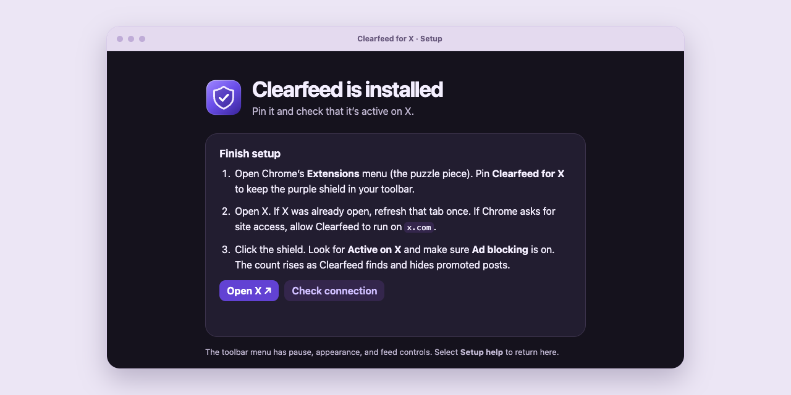

# Clearfeed for X

Clearfeed is a free Chrome extension for macOS that hides labeled promoted posts and trends on X. The toolbar menu lets you pause blocking, view your per-tab and all-time counts, hide sidebar suggestions, and switch appearance.

## Install on macOS

1. Download the **macOS ZIP** from the [latest release](https://github.com/nikkitaylor00/clearfeed-for-x/releases/latest) and extract it.
2. Double-click **Install Clearfeed.command**. It copies the files to your user Library and opens Chrome's Extensions page and a guide with the folder path. If your Mac prevents the script from opening, open **Start Here.html** from the extracted folder for manual setup.
3. In Chrome, turn on **Developer mode**, click **Load unpacked**, and select the **extension** folder shown in the guide.
4. Follow the welcome page to pin Clearfeed, open or refresh X, and check the connection. To open the guide again, choose **Setup help** in the toolbar menu.

Use Google Chrome 123 or newer. The installer requires no administrator privileges. If you load the extension directly from the ZIP, keep the extracted folder in place. Chrome's [unpacked extension guide](https://developer.chrome.com/docs/extensions/get-started/tutorial/hello-world#load-unpacked) describes the approval step.

## Updates and removal

GitHub updates are manual. Download and extract the new release, run **Install Clearfeed.command** again, click **Reload** on Clearfeed's existing card at `chrome://extensions`, then refresh X. If you installed manually, copy the contents of the new release's **extension** folder over the existing loaded folder before clicking **Reload**. Updating the same folder preserves your extension settings and all-time count.

To remove Clearfeed, click **Remove** on its card at `chrome://extensions`. If you ran the installer, you can then delete `~/Library/Application Support/Clearfeed for X`.

## Scope and privacy

Clearfeed processes already loaded posts only on `x.com` and `www.x.com`. It keeps preferences and the all-time count in Chrome's local extension storage and does not transmit browsing data. The count for the current tab restarts on page load. Clearfeed recognizes ads marked by X. Unlabeled sponsorships may still appear, and changes to X’s feed can require a Clearfeed update. Clearfeed is independent of X.

## Build from source

The extension has no runtime dependencies. To load development code, select this repository folder in **Load unpacked**. To build the same macOS ZIP as the release, run `./scripts/package-macos.sh`. Packaging requires Node.js and `zip`.
